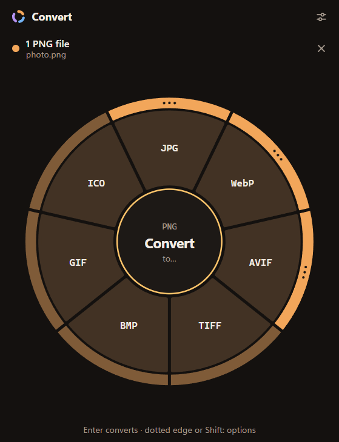

# Convert

Offline drag-and-drop file converter for Windows. Drop files on the window, pick a target format
from the wheel, and the result appears next to the original. Nothing is uploaded: every
conversion runs on your computer.



## Install

Download `Convert-Setup-<version>.exe` from the [Releases](../../releases) page and run it. It
installs for the current user, no administrator rights needed.

The installer is not code-signed, so Windows SmartScreen shows a warning: choose
**More info → Run anyway**.

A portable build (`Convert-<version>-portable.exe`) is also published. It needs no installation,
but starts slower and the Explorer right-click entry is only reliable with the installed version.

## Use

- **Drop files** on the window, or click it to browse. The wheel shows every format all selected
  files can be converted to.
- **Click a slice** (or drop directly on it) to convert. The output is written next to the
  source; existing files are never overwritten (`name (1).ext`).
- **Options** such as quality or bitrate: click the dotted outer edge of a slice, or press
  `Shift+Enter`.
- **Keyboard:** arrows move around the wheel, `Enter` converts, `Esc` cancels, typing a letter
  jumps to a format, `Ctrl+O` opens the file picker.
- **Tray:** closing the window keeps Convert in the tray. `Ctrl+Alt+C` shows or hides it
  (configurable).
- **Explorer:** right-click files → **Convert with Convert** (on Windows 11, under "Show more options").

## Supported conversions

| Kind | Formats |
| --- | --- |
| Images | jpg, png, webp, avif, tiff, bmp, gif, ico in any direction; svg as input |
| Audio | mp3, m4a, wav, flac, ogg, opus, aiff, wma in any direction |
| Video | mp4, mov, mkv, webm, avi, wmv in any direction; video → gif; audio extraction to mp3, m4a, wav |
| Documents | md, html, txt, docx, rtf, odt → md, html, txt, docx, pdf, epub |
| PDF | → txt, md, html, docx (text flow only), png / jpg (one image per page) |
| EPUB | ↔ html, md, txt, docx, pdf |
| Spreadsheets | xlsx, xls, ods, csv, tsv, json → xlsx, ods, csv, tsv, json, html |
| Archives | zip ↔ tar ↔ tar.gz |
| Subtitles | srt ↔ vtt, → txt |
| Slides | pptx → txt, md (slide text and speaker notes) |

Not supported: HEIC, 7z, RAR, legacy `.ppt`, and rendering PowerPoint slides to PDF or images.
Document conversions keep structure (headings, lists, tables, links, images) but not page layout,
fonts or colors.

## Development

Requires Node.js 22+ and pnpm.

```sh
pnpm install
pnpm dev          # run with hot reload
pnpm typecheck
pnpm test         # runs real conversions on fixtures generated at test time
pnpm dist         # build the installer and portable exe into release/
```

If `node_modules/electron/dist` is missing after installing, run `node node_modules/electron/install.js`.

### Layout

- `src/shared/` — format catalog and the contracts between processes (`Converter`, `Job`, `Settings`, `ConvertApi`).
- `src/main/converters/<domain>/` — one folder per domain; each exports `converters` and is
  loaded automatically by `src/main/registry.ts`.
- `src/main/jobs.ts` — job queue: collision-free output paths, concurrency, cancellation, cleanup.
- `src/main/shell/` — tray, global shortcut, Explorer integration, window behavior.
- `src/renderer/` — React interface.

To add a format, create or extend a converter under `src/main/converters/`, list any new
extension in `src/shared/formats.ts`, and add a test. `src/main/converters/subtitle/` is the
smallest complete example.

## Third-party components

Convert bundles [FFmpeg](https://ffmpeg.org) (through `ffmpeg-static`, a GPL build),
[sharp](https://sharp.pixelplumbing.com) / libvips, [PDF.js](https://mozilla.github.io/pdf.js/)
and [SheetJS](https://sheetjs.com), each under its own license.
